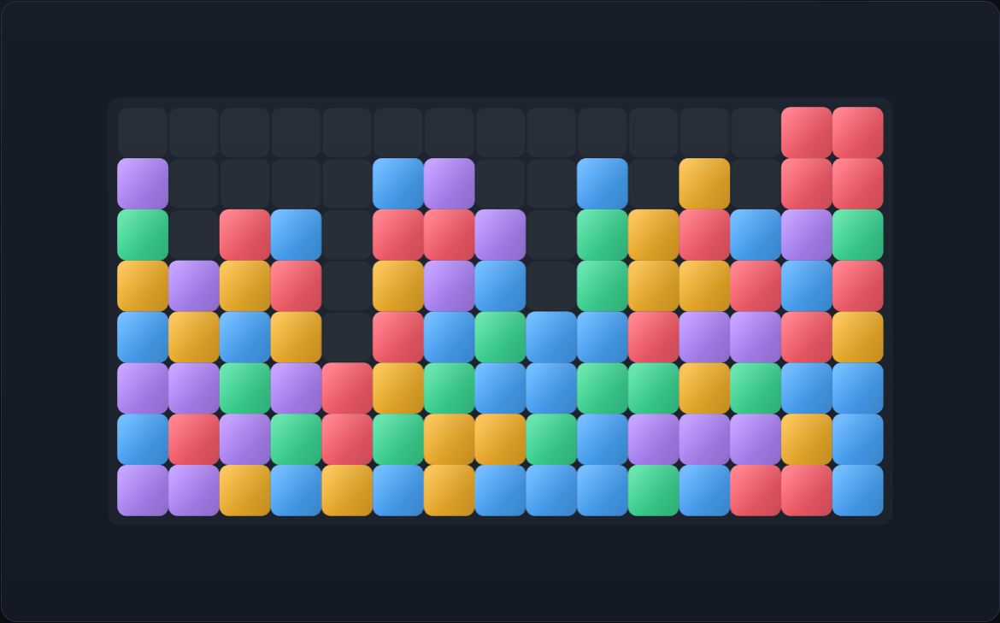

# SameGame

**Play:** https://bazoocaze.github.io/samegame/ — one HTML file, nothing to install, nothing to
download. Best score is saved in your browser.

## How to play

1. Click a group of **2 or more** same-colour blocks (touching orthogonally) to pop it.
2. Blocks fall down; empty columns slide left.
3. Score for a group of `n` is `n × (n − 1)`, so big groups are worth much more than small ones.
4. Clear the whole board for a `+2000` bonus.

| Group size | 2 | 3 | 5 | 10 | 15 | 20 |
|---|---|---|---|---|---|---|
| Points | 2 | 6 | 20 | 90 | 210 | 380 |

Board sizes 8×8 through 16×12, 3–6 colours. Best score is kept per size/colour count.

## Controls

| Action | Key |
|---|---|
| Pop a group | click / tap |
| New game | `N` |
| Undo | `U` |
| Hint (best group) | `H` |
| Shuffle | `S` |
| Sound on/off | `M` |

Hovering a group highlights it and shows its points. Sound is generated in the browser, no audio files.

## License

[MIT](LICENSE)
